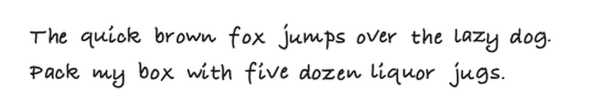

# Handwriting plotter (Bambu X2D + pen holder)


*SVG preview rendered from the bundled test glyph set (`tests/glyphs_fake.json`), not real handwriting.*

Pipeline: **your handwriting → single-line strokes (`glyphs.json`) → text laid out in your hand → SVG preview → G-code**.

One-time setup (already done here): `python3 -m venv .venv && .venv/bin/pip install numpy pillow scikit-image`

## 1. Get your handwriting in (pick one)

**A. Draw it on screen** – open `capture.html` in a browser, write each character 3 times (stylus/finger/mouse), click *Download glyphs.json*, put the file in this folder.

**B. Write on paper and scan it** (best pen feel)
```
.venv/bin/python make_template.py            # makes template.pdf (4 pages, US Letter)
# print at 100%, fill every square with a dark pen, scan flat at ~300 dpi
.venv/bin/python scan_to_glyphs.py template/meta.json s1.png s2.png s3.png s4.png -o glyphs.json
```
Keep scans flat and unrotated, black frame fully visible, nothing dark outside it.

**C. Copy a page you already wrote** (no typing new text, reproduces it stroke for stroke)
```
.venv/bin/python trace_page.py page.jpg --width-mm 140 -o out/traced
```
Free-form handwriting cannot be cut into per-letter glyphs reliably (that needs handwriting recognition), which is why A and B use known squares.

## 2. Write text

```
.venv/bin/python write.py -g glyphs.json -t "Dear Sam, thanks for dinner!" -o out/note --paper a5
```
Open `out/note.svg` to preview. Options: `--xheight` (mm), `--pitch` (line spacing mm), `--jitter 0..1`, `--seed`, `-f file.txt`.
The X2D bed is 256 mm, so US Letter (279 mm tall) does not fit; use a5, halfletter, 4x6 or a custom `WxH`.

## Holding the paper

Tape is enough. Use low-tack painter's or washi tape on all four edges, pulled flat. To put the paper in the same spot every time, print `fixture/corner_stop.stl` (70 x 70 mm L, 10 mm wide, 1.2 mm tall; 0.2 mm layers, PLA), tape it to the plate's front-left, and push the paper's corner into the inside of the L. That inside corner is your `paper_origin_mm` (measure it once). Keep the writing margin (default 12 mm) wider than the 10 mm stop, and check the pen holder clears the stop on a dry run with the pen out. The paper should sit on something smooth and flat (a smooth plate side, or a sheet of glass or stiff board taped down), because the pen's spring pressure can emboss a textured plate into the paper.

## 3. Make it real (G-code is blocked until all of this is filled in `plotter.json`)

1. **Header/footer (the risky part, and yours to do: I could not verify X2D start G-code from here).** A normal print start sequence assumes the *nozzle* is the lowest point; with the pen holder the pen tip hangs lower, so any bed-touching or probing move (Z homing, G29 bed leveling, nozzle wipe, tool-switch moves) can drive the pen into the plate and snap the holder.
   - **Preferred:** generate a tiny test file with [BambuPlot](https://makerworld.com/en/models/2993044-bambuplot-free-pen-plotter-g-code-generator) (it is what X2D pen-holder users run, so its start/end sequence is pen-safe), copy everything before its first drawing move into `gcode/header.gcode` and the closing lines into `gcode/footer.gcode`. Its pen-up/pen-down Z values are also a good starting point for `z_up`/`z_down`.
   - **If you slice instead:** delete all heating (M104/M109/M140/M190), G29/bed leveling, wipe, purge, nozzle-switch/tool-change, calibration and extrusion blocks. Any Z probe that remains will hit the pen before the nozzle, so remove it unless you have proven it is pen-safe.
   - Then set `"header_verified": true`.
   - To run: copy the `.gcode` to a USB stick and start it from the printer's screen (the holder's users say USB runs do not heat the nozzle).
2. **`pen_offset_mm`**: `[dx, dy]` of the pen tip relative to the nozzle (measure it).
3. **`paper_origin_mm`**: bed position of the paper's front-left corner.
4. **Pen height**: `calibrate.py --z-start <Z clearly above paper> --step 0.2 --count 20`, run it, find the first line that marks the paper, then set `z_down` (a little lower; the spring forgives about 0.5 mm) and `z_up` (2-3 mm above `z_down`).
5. `write.py` re-checks every move against `bounds_mm` and refuses to write G-code that leaves it.

The first real run: slow it down (lower `feed_draw`), stay at the printer, keep a hand near stop. The community holder has small pins that can snap and fall into the toolhead, so inspect it first.

**Fallback with a known-good header:** `out/*.svg` is paper-sized in mm, so you can feed it to [BambuPlot](https://makerworld.com/en/models/2993044-bambuplot-free-pen-plotter-g-code-generator) (what the holder's users run from a USB stick). Watch its scaling setting.
